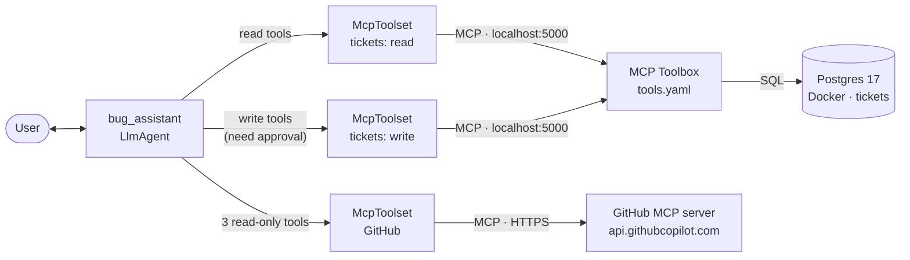

# Bug Assistant (ADK + MCP)

An ADK agent that helps a software team triage bugs. It searches, files, and updates tickets in a **Postgres** database, cleans up duplicate tickets, gives a backlog overview, and checks **GitHub** for known issues in outside libraries.

It gets all of its tools from **two MCP servers**, and its Python code defines no tools of its own:

- **[MCP Toolbox for Databases](https://github.com/googleapis/mcp-toolbox)** turns SQL statements in [tools.yaml](tools.yaml) into MCP tools for the ticket database.
- **[GitHub's MCP server](https://github.com/github/github-mcp-server)**, hosted by GitHub, provides issue and repository search.

> `Users say the Safari login page is just blank`
> → calls `search-tickets` → *"I found #9 [P1, Open] Safari login shows blank screen (score 0.79) and #1 [P1, Open] Login page crashes on Safari (0.45). Use one of these instead of a new ticket?"*

> `Any duplicate tickets?` → *#3 / #10 (0.32), #1 / #9 (0.28)* → `close 10 as a duplicate of 3` → **ADK pauses for your approval** → #10 closed and linked to #3.

## How it works



`McpToolset` connects to a server, asks it which tools it has, and turns each one into a normal ADK tool. The model sees each tool's name, description, and inputs, decides which to call, and ADK runs the call over MCP. Neither server has AI in it: Toolbox runs SQL, and GitHub runs API queries. The only model is the agent's Gemini.

| Tool | Server | What it does |
|---|---|---|
| `search-tickets` | Toolbox | Fuzzy search on title + description (pg_trgm), best match first, with a score |
| `get-ticket`, `list-open-tickets` | Toolbox | One ticket / all non-closed tickets, P0 first |
| `find-duplicate-tickets` | Toolbox | Scans every pair of open tickets for likely duplicates |
| `triage-summary` | Toolbox | Open tickets per priority, unassigned P0/P1, oldest open tickets, in one query |
| `create-ticket` ✋ | Toolbox | New ticket with a fixed layout: steps, expected, actual, environment, error |
| `update-ticket-status` ✋, `assign-ticket` ✋ | Toolbox | Small single-purpose updates |
| `mark-duplicate` ✋ | Toolbox | Closes a ticket and links it to the original (`duplicate_of`) |
| `search_issues`, `issue_read`, `search_repositories` | GitHub | Find known issues in a library's repo |

✋ = ADK pauses and asks a human to approve the exact call before it runs.

| File | Purpose |
|---|---|
| [agent.py](agent.py) | `root_agent`, the three toolsets, and the GitHub cost/guard callback |
| [config.py](config.py) | Model, server URLs, tool lists, and limits in one place |
| [tools.yaml](tools.yaml) | Toolbox config: the Postgres source and 9 SQL tools |
| [db/init.sql](db/init.sql) | Table, trigram index, and 11 sample tickets (with planted duplicates) |
| [docker-compose.yml](docker-compose.yml) | Local Postgres 17 on port 5433 |
| [run_toolbox.sh](run_toolbox.sh) | Starts Toolbox on localhost with the DB settings from `.env` |

## What this version adds

The starting point was Google's [software-bug-assistant](https://github.com/google/adk-samples/tree/main/python/agents/software-bug-assistant) sample. This version changes and adds:

- **Duplicate detection without embeddings.** `find-duplicate-tickets` scores every pair of open tickets with Postgres `pg_trgm` (the higher of title-vs-title and full-text similarity). On the sample data, the real duplicates score 0.28–0.32 and the closest unrelated pair 0.19, so the cutoff is 0.25. It's free, local, and needs no embedding API. `mark-duplicate` closes the copy and keeps a link to the original, and the database rejects a self-link or a missing ID.
- **Backlog overview in one call.** `triage-summary` returns counts, urgent unassigned work, and the oldest open tickets as one row of small JSON values.
- **Approval enforced by code, not by the prompt.** The Toolbox tools are loaded as **two toolsets**, split with `tool_filter`: read tools run freely, and write tools use `require_confirmation=True`. Text from public GitHub issues is written by strangers and could try to talk the model into a write (prompt injection). With this split, nothing in the database changes until a person clicks approve.
- **Tickets someone can reproduce.** Before filing, the agent asks once for steps, expected result, actual result, and environment. `create-ticket` requires that layout in its description, and anything unknown is written as "unknown".
- **Small, single-purpose write tools** (`update-ticket-status`, `assign-ticket`) instead of one "update anything" tool, so the model can't change fields it wasn't asked to. `CHECK` constraints reject bad priorities and statuses.

## Cost control

The model is `gemini-3.5-flash-lite`. Each tool's description is sent with every message, and each tool result is sent back to the model, so both are kept small:

- **3 of GitHub's ~100 tools**, limited twice: on the server with the `X-MCP-Tools` header, and in ADK with `tool_filter`.
- **A `before_tool_callback` on GitHub searches** caps results at 5 (the default is 30) and asks only for `number, title, state, html_url, comments, created_at`. Measured on `uuidjs/uuid`: **~4,700 → ~260 tokens per search (18× smaller)**. One full issue via `issue_read` is ~520 tokens.
- **Searches the ticket database once** per new bug report, and not again while the user is only adding details.

## Safety

- **GitHub is read-only**: a fine-grained token with *Public repositories (read-only)* access, plus the `X-MCP-Readonly` header so write tools are never offered.
- **Toolbox is locked to this machine**: `--address 127.0.0.1`, `--allowed-hosts 127.0.0.1,localhost` (blocks DNS-rebinding), and `--allowed-origins` limited to its own address, so a web page open in your browser can't call the tools. The default for both is `*`.
- **Write tools need approval** (see above), and the prompt tells the model to treat GitHub text as information only.
- Database credentials and the GitHub token live only in `.env` (git-ignored). `tools.yaml` reads them as `${DB_PASSWORD}` and so on.

## Run locally

From the repository root:

```bash
python3.13 -m venv .venv && source .venv/bin/activate
pip install -r requirements.txt                      # includes google-adk[mcp]
cp bug_assistant_agent/.env.example bug_assistant_agent/.env
#   add your Gemini API key, and optionally a read-only GITHUB_TOKEN

# 1. database (Docker)
docker compose -f bug_assistant_agent/docker-compose.yml up -d --wait

# 2. MCP Toolbox (macOS Apple Silicon; see the Toolbox releases for other platforms)
curl -L -o bug_assistant_agent/toolbox \
  https://storage.googleapis.com/mcp-toolbox-for-databases/v1.17.0/darwin/arm64/toolbox
chmod +x bug_assistant_agent/toolbox
./bug_assistant_agent/run_toolbox.sh                 # leave running in its own terminal

# 3. agent (second terminal)
adk web
```

Open http://127.0.0.1:8000 and pick **bug_assistant_agent**. Without `GITHUB_TOKEN`, the agent runs with the ticket tools only. When a write tool asks for approval, tick **Confirmed** and **Submit** to approve, or submit without ticking it to reject.

To reset the sample data: `docker compose -f bug_assistant_agent/docker-compose.yml down -v`, then `up` again.

## Problems found while building

- **Toolbox v1 changed its config format.** The repo moved to `googleapis/mcp-toolbox`, `tools.yaml` became one YAML document per item (`kind: source` / `kind: tool` / `kind: toolset`, separated by `---`), and the flag is `--config`. Older tutorials use the v0 `sources:`/`tools:` maps, which no longer load.
- **GitHub `search_issues` silently returned 0 results.** GitHub's REST search found 700 issues for the same words with the same token. In the current server, `search_issues` is a semantic search that only works inside one repository, so without `owner` and `repo` it returns nothing, with no error. The callback now blocks such calls and tells the model to find the repository first with `search_repositories`.
- **Toolbox accepted requests from any website by default.** At startup it warned that `*` hosts and origins allow DNS rebinding and cross-site calls. Locking both down was tested: a fake `Host` header gets 403, and a foreign `Origin` gets no CORS permission. The Python MCP client is unaffected.

## Credits

Based on Google's [software-bug-assistant](https://github.com/google/adk-samples/tree/main/python/agents/software-bug-assistant) ADK sample. Rebuilt on MCP Toolbox v1 and the hosted GitHub MCP server, with free trigram duplicate detection, a one-call triage summary, approval enforced in code for every write, GitHub cost caps, and a locked-down local Toolbox.
