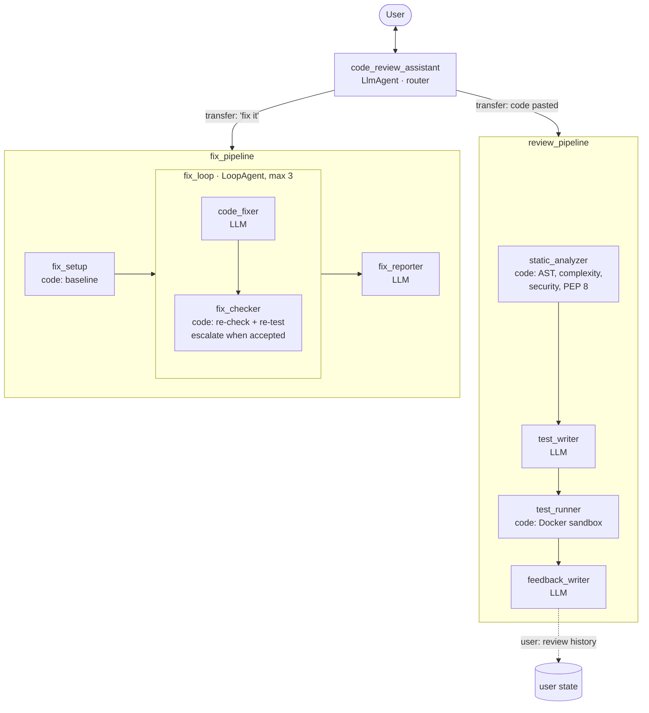

# Code Review Assistant (ADK)

An ADK agent that reviews Python code and can fix it. You paste code and get a review covering **structure, complexity, PEP 8 style, security risks, and test results**. Then, if you want, it fixes the code, re-runs the tests, and only accepts a version that doesn't make anything worse.

The design rule: **exact work in code, judgment in the model.** Parsing, style checks, security rules, running tests, and deciding whether a fix is good enough are plain Python (free, and the same result every time). The model only writes tests, writes the review, and rewrites code.

> *Paste:* `def Average(nums):` with `total=0`, `for n in nums: total+=n`, `return total/len(nums)`
> → `🔍 Static analysis: style 71/100 · security findings 0` → `🧪 Sandbox (Docker, no network): 7/7 tests passed`
> → *"Needs improvement · Style 71/100 · Security 0 · Tests 7/7 · Max complexity 2"*, then 🟡 missing docstring (line 1) and 🔵 snake_case name, operator spacing, one-line loop (lines 1–3).
> → `yes, fix it` → `🔁 Attempt 1/3: tests 7/7 ✅ · style 94/100, security 0 → accepted` → before/after table and the fixed code.
>
> *(From the `adk eval` run. Every number comes from the tools, not from the model.)*

## How it works



Steps marked *code* are **custom agents**: `BaseAgent` subclasses with a `_run_async_impl` that does the work in Python and yields Events. They write their results to session state, and the next step reads them through `{key}` in its instruction.

| File | Purpose |
|---|---|
| [agent.py](agent.py) | The router, the 4 LLM workers, the two pipelines, and the loop |
| [steps.py](steps.py) | The custom (non-AI) agents: `StaticAnalyzer`, `TestRunner`, `FixSetup`, `FixChecker`, `Pipeline`, and the review-memory callback |
| [analysis.py](analysis.py) | AST structure, cyclomatic complexity, security rules, PEP 8 style score |
| [sandbox.py](sandbox.py) | Runs generated tests in a locked-down, throw-away Docker container |
| [config.py](config.py) | Model, limits, sandbox settings |
| [tests/](tests/) | 21 unit tests for the non-AI parts (free) |
| [evals/](evals/) | `adk eval` test set: routing and full review → fix conversations |

## Key ideas

- **Transfer, not AgentTool.** The root agent hands the conversation to a pipeline (`sub_agents=[...]`), and the pipeline answers the user directly. After it finishes, the next message goes back to the root, because pipeline agents can't keep the conversation.
- **State is the notebook between steps.** `static_analyzer` writes `analysis_report` and `metrics`, `test_writer` writes `tests` (`output_key`), `test_runner` writes `test_report`, and the LLM steps read them with `{key}`. Worker LLMs use `include_contents="none"`, so they see only their instruction and not the whole chat history (fewer tokens per call).
- **A loop with a stop rule in code.** `fix_loop` is a `LoopAgent` (max 3). After each fixer attempt, `fix_checker` re-runs all checks and the same tests. It accepts only if **all tests pass, the style score is not lower, no high security finding is left and none is new, and no function became too complex**. Then it yields `escalate=True`, which ends the loop. Otherwise the reasons become the next attempt's prompt. If no attempt passes, the best one is shown, marked *not fully fixed*, with what is still open.
- **Review memory across sessions.** After each review, a callback appends a short record (scores and kinds of issues) to `user:review_history`. The `user:` prefix keeps it for that user across all sessions. The next review gets a progress line ("style 38 → 100") and points out mistakes that keep coming back.

## What this version adds

The starting point was Google's code-review-assistant codelab ([ayoisio/adk-code-review-assistant](https://github.com/ayoisio/adk-code-review-assistant)). This version adds:

1. **Security scan (AST rules):** `eval`/`exec`, `os.system`, `subprocess(..., shell=True)`, `pickle`/`marshal` loads, `yaml.load` without `SafeLoader`, `verify=False`, `md5`/`sha1`, `tempfile.mktemp`, hard-coded secrets (assignments, keyword args, and hard-coded fallbacks like `os.getenv("KEY", "secret")`), and bare `except:`. Findings are sorted high → low.
2. **Complexity per function:** cyclomatic complexity from the AST (branches, loops, `and`/`or`, comprehensions, `except`, `case`). Above 10 is flagged as too complex to test well.
3. **A stricter, code-enforced "done" rule** for the fix loop (above). In the original, a model decides whether the fix worked. Here, plain Python decides from real numbers.
4. **Review memory** in `user:` state, with progress and repeated-mistake notes.

Also changed:

- **Tests run in Docker on this machine, not in the model's code tool.** The test results are real numbers (`passed`/`total`) that the stop rule can trust.
- **The pipelines stop early on bad input.** No code, a syntax error, too many lines, or "fix it" without a review all end before any model call.

## Running untrusted code safely

The pasted code and the generated tests are untrusted, so they never run on the host. Each test run gets a fresh container:

`--network none` · `--read-only` (plus a 16 MB `/tmp`) · code mounted read-only · `--user 65534` (nobody) · `--cap-drop ALL` · `no-new-privileges` · 256 MB memory · 64 processes · 30 s timeout (then `docker kill`) · `python -I`

Inside, a small runner prints the result as one JSON line that starts with a random marker, so output printed by the code under test can't fake a result. That output is also capped at 64 KB. The unit tests check that writing files and opening network connections fail, that `sys.exit()` while loading is caught, and that a fake result line is ignored.

## Problems found while building

- **`ctx.end_invocation = True` in a custom agent did not stop the rest of a `SequentialAgent`.** In a free test run with canned model outputs, the "no code found" path kept going and crashed in the next step. In ADK 2.14 every agent runs on its own copy of the invocation context, so the flag set by one step never reaches its parent. The fix is a 10-line `Pipeline` agent that runs its steps in order and stops when a step writes `halt=True` to **state**, which all steps share.
- **The style score was useless for short snippets.** The first `adk eval` run scored a 4-line function with 5 small PEP 8 issues **0/100**, because the score was "issues per line". It is now `100 − 100 × issues / (lines + 10)`, so the same function scores 71 and a long file is barely affected. The missing final newline that pasted code always has (W292) is also no longer counted.
- **The fixer gamed the security rule.** In a recorded demo, the fix turned `API_KEY = "sk-live-..."` into `API_KEY = os.environ.get("API_KEY", "sk-live-...")`, which still contains the secret, now as a fallback. The rule only matched a string assigned directly, so the checker accepted it. Now a secret-named variable that falls back to a literal (`os.environ.get(..., "...")`, `os.getenv(..., default=...)`, `os.getenv(...) or "..."`) is a high finding too, the fixer is told "no hard-coded default", and 3 unit tests cover it. Lesson: when an AI is optimised against a checker, it finds the checker's gaps, so test the checker with the AI's real outputs.
- **The generated tests decide what "correct" means for edge cases.** For `Average([])`, the test writer chose "raises ZeroDivisionError" as the expected behaviour, so the original code passed 7/7. The review then correctly reported no failing tests instead of inventing one: the feedback writer only uses the tool results it is given.

## Run locally

From the repository root:

```bash
python3.13 -m venv .venv && source .venv/bin/activate
pip install -r requirements.txt                       # includes pycodestyle
cp code_review_agent/.env.example code_review_agent/.env   # add your Gemini API key
docker pull python:3.13-alpine                        # the test sandbox image (17 MB)
adk web
```

Open http://127.0.0.1:8000, pick **code_review_agent**, and paste some Python. Without Docker, reviews still work, but the test step reports that the sandbox is unavailable.

```bash
python -m unittest discover -s code_review_agent/tests -t . -v      # free unit tests
adk eval code_review_agent code_review_agent/evals/routing.evalset.json \
    --config_file_path code_review_agent/evals/test_config.json --print_detailed_results
```

The eval set has 4 conversations: a capabilities question, a review request without code, a review, and review → "yes, fix it". It scores **tool trajectory** (did the router transfer to the right pipeline, or not at all?) and **response match** (ROUGE overlap with a reference answer, with a loose 0.2 threshold because review wording varies).

Latest run: **4/4 passed**, trajectory 1.0 in every case, and response match 0.52–0.88. A review is 3 model calls and ~2,200 tokens, and the whole eval is ~8,700 tokens, **under $0.01**. ADK's eval also reports call counts, tokens, and duration per turn.

## Cost control

- **Plain Python for every exact step:** 4 of the 8 pipeline steps make no model calls.
- **Cheapest model** (`gemini-3.5-flash-lite`) everywhere.
- **Workers use `include_contents="none"`:** they get only the code and reports from state, not the chat history, which also keeps a long chat from making every call bigger.
- **Short prompts:** only the first 12 style issues are sent to the model.
- **Early exits:** no code, a syntax error, more than 400 lines, or a fix without a review stop **before any model call**.
- **Loop cap:** at most 3 fix attempts (one model call each).

## Credits

Based on Google's [Build a production code review assistant with ADK](https://codelabs.developers.google.com/adk-code-reviewer-assistant/instructions) codelab ([ayoisio/adk-code-review-assistant](https://github.com/ayoisio/adk-code-review-assistant)). Rebuilt with custom (non-AI) agents for every exact step, a Docker sandbox, AST security and complexity checks, a code-enforced acceptance rule for the fix loop, cross-session review memory, and an `adk eval` test set.
