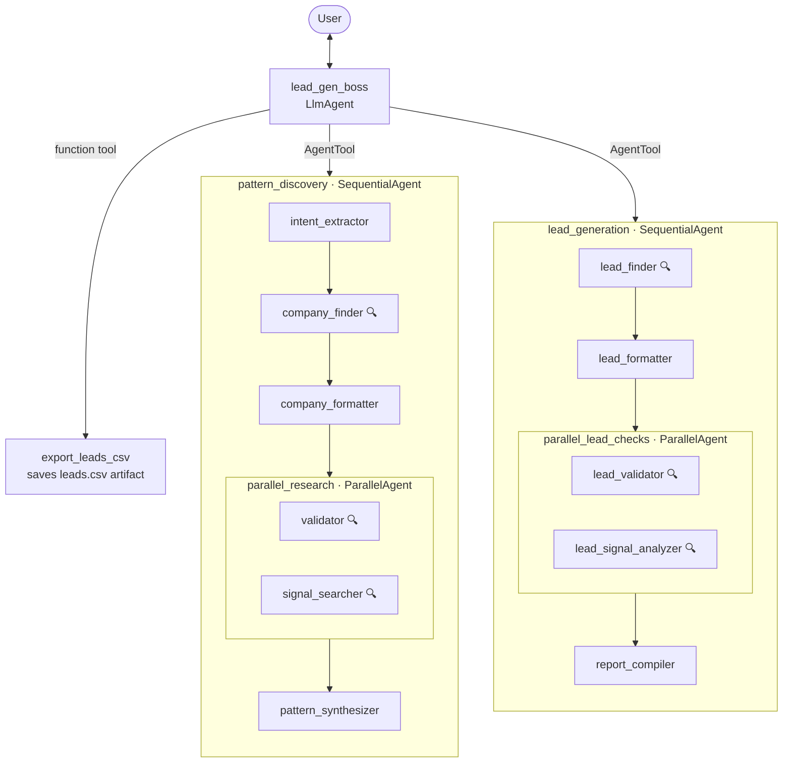

# Deep Research Lead Generator

A multi-agent research system that finds B2B sales leads. It works the way an analyst would: first it studies companies that **already** invested in a market to learn which signals came before the investment, then it looks for companies showing those **same signals today** that haven't invested yet.

> *"Which EV battery companies might invest in the USA?"*
> → it studies past investors (Panasonic, LG Energy Solution, ...) → finds patterns like *state incentive approvals 3–6 months before a site announcement* → returns ranked leads (Freyr Battery, InoBat, ...) with sources and a downloadable `leads.csv`.

## Architecture



🔍 = uses Google Search grounding.

| Agent | Job | Writes to state |
|---|---|---|
| `intent_extractor` | Turns the request into `{industry, country, num_companies}` | `intent` |
| `company_finder` → `company_formatter` | Finds companies that already invested, then structures the list | `raw_companies`, `companies` |
| `validator` ∥ `signal_searcher` | In parallel: fact-checks each company / finds signals from 6–24 months before its investment | `validation`, `signals` |
| `pattern_synthesizer` | Finds patterns shared by at least 2 valid companies | `patterns` |
| `lead_finder` → `lead_formatter` | Finds mid-sized/emerging companies showing those patterns with no plant in the country yet | `raw_leads`, `leads` |
| `lead_validator` ∥ `lead_signal_analyzer` | In parallel: yes/no checks (foreign HQ? already has a plant?) / scores each lead 1–10 | `lead_validation`, `lead_signals` |
| `report_compiler` | Keeps only VALID leads and ranks them | `lead_report` |
| `lead_gen_boss` | Talks to the user, runs the pipelines, **asks for confirmation between them**, presents results | — |

## ADK concepts used

- **Structured output** (`output_schema` + Pydantic) for every hand-off between agents ([schemas.py](schemas.py))
- **Session state** (`output_key` writes, `{placeholder}` reads in instructions) to pass data between agents
- **Workflow agents**: `SequentialAgent` for fixed order and `ParallelAgent` for independent research
- **AgentTool**: each pipeline is exposed to the boss as a single tool
- **Built-in tool** `google_search` for grounded, sourced research
- **Callbacks**: `after_agent_callback` replaces Google's temporary grounding-redirect links with the real article URLs ([tools.py](tools.py))
- **Artifacts**: the boss saves the final report as a downloadable `leads.csv`
- **Retries**: the shared model object retries on `503`/`429` with exponential backoff ([config.py](config.py))

## Run it

From the repository root:

```bash
python3.13 -m venv .venv && source .venv/bin/activate
pip install -r requirements.txt
cp lead_gen_agent/.env.example lead_gen_agent/.env   # then add your Gemini API key
adk web
```

Open http://localhost:8000, pick **lead_gen_agent**, and try:

1. `Which EV battery companies might invest in the USA? Study 2.` → it shows the discovered patterns and asks whether to continue
2. `yes` → it shows a ranked lead table, and `leads.csv` appears in the **Artifacts** tab

A full run makes about 15 Gemini calls and takes 3–5 minutes.

### Seeing the inner agents (`SHOW_FLOW`)

`AgentTool` runs each pipeline in its own nested session, so `adk web` only draws the boss and its tools. To see every inner agent in the graph view, set `SHOW_FLOW` in `.env` and restart `adk web`:

| `SHOW_FLOW` | Root agent |
|---|---|
| *(unset)* | `lead_gen_boss`: chat with a confirmation step |
| `pattern_discovery` | Pipeline 1 only |
| `lead_generation` | Pipeline 2 only (needs pipeline 1 earlier in the same session) |
| `full` | Both pipelines back to back, every agent visible, no confirmation |

## Design notes

- **Why `SequentialAgent` and not ADK 2.x `Workflow`?** The pipelines were first built as `Workflow` graphs (with `JoinNode` fan-in). But `AgentTool` can't run a `Workflow` (`'Workflow' object has no attribute 'sub_agents'`), and Workflow's built-in pause-for-input doesn't resume on a plain chat reply. `SequentialAgent`/`ParallelAgent` are deprecated in 2.x but are the only option that supports a chat-driven boss with a confirmation step.
- **One job per agent.** An agent with `output_schema` can't use tools, so every search agent is paired with a formatter that structures its output.
- **Plain yes/no checks.** The lead validator first used a double negative ("has NOT invested … INVALID if the check fails"), and the model inverted it. Rewriting it as two yes/no questions with an explicit rule and examples fixed the verdicts.

## Credits

Based on the architecture described in Google Cloud's [Build a deep research agent with Google ADK](https://cloud.google.com/blog/products/ai-machine-learning/build-a-deep-research-agent-with-google-adk) and the [leadGenerationAgentADK](https://github.com/MagnIeeT/leadGenerationAgentADK) sample. Rebuilt for ADK 2.x and extended with real-URL resolution, stricter lead validation, CSV export, and the `SHOW_FLOW` demo switch.
