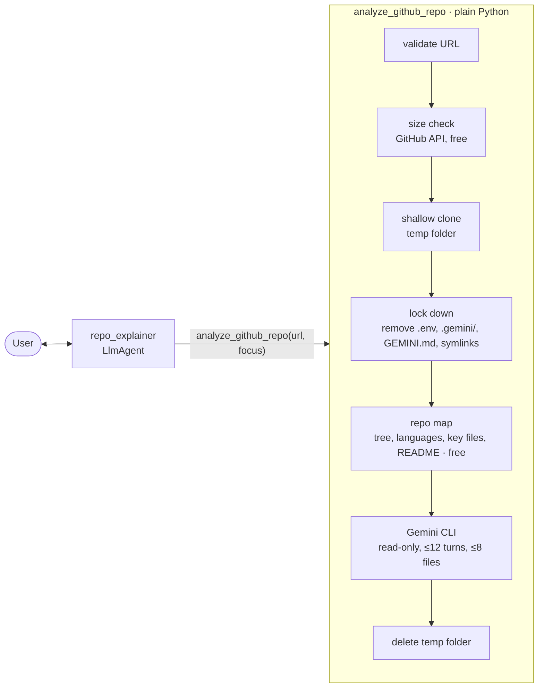

# GitHub Repo Explainer (ADK + Gemini CLI)

An ADK agent that explains any public GitHub repository. You paste a link, and it returns a short review: **what the project does, its architecture, how to run it, and its top 5 risks**, with file paths.

The actual code reading is done by **[Gemini CLI](https://github.com/google-gemini/gemini-cli) running as a tool inside the ADK agent**: an agent inside a tool inside an agent. Everything around it (downloading, cleaning, summarizing) is plain Python, so it's fast, cheap, and hard to misuse.

> `Explain https://github.com/pallets/itsdangerous`
> → *pallets/itsdangerous (Python, 3,144 stars, 0.9 MB)*: a 4-section report covering `Signer`/`Serializer`/`URLSafeSerializer`, how to run it, and risks such as a SHA-1 default digest and an unchecked zlib decompression in `url_safe.py`.
> *Analyzed 46 files in 2 model calls, about $0.02.*

## How it works



The agent decides **when** to call the tool and how to present the result. The tool runs the same fixed steps every time, in code: **code for fixed steps, an agent only where judgment is needed.**

| File | Purpose |
|---|---|
| [agent.py](agent.py) | `root_agent`: one `LlmAgent` with one tool |
| [repo_tools.py](repo_tools.py) | The tool: validate → size check → clone → lock down → repo map → Gemini CLI → cleanup |
| [config.py](config.py) | Every cost and safety limit in one place |
| [Dockerfile](Dockerfile) | Python 3.13 + Node 24 + Gemini CLI + git, running as a non-root user |

## Cost control

Agent loops get expensive because **every turn re-sends everything read so far**, and Gemini CLI adds about 10K tokens of built-in instructions per turn. So the design keeps turns and reading small:

- **Free repo map first:** Python builds a summary (folder tree, file types, key files, README start) and passes it in the prompt, so Gemini CLI doesn't spend turns exploring.
- **Ignore lists** (`.geminiignore`): `node_modules/`, lock files, images, and build output are never read.
- **Hard caps:** at most 12 model calls (`maxSessionTurns`), 8 files, 4 minutes, and repos up to 50 MB, which is checked *before* downloading.
- **Cheapest current model** (`gemini-3.5-flash-lite`) for both the agent and Gemini CLI.
- **Usage reported every run**, using Gemini CLI's `-o json` stats.

Measured on `pallets/itsdangerous`: **2 model calls, 8 files, ~35K input tokens, ~$0.016, 9 seconds.**

## Safety

A downloaded repo is untrusted input, and Gemini CLI automatically loads some files from the folder it runs in. Before it runs, the tool:

- accepts only `https://github.com/<owner>/<repo>` links (no local paths or other hosts, and no `;` tricks)
- **deletes** the repo's own `.env*` (could swap the API key), `.gemini/` (its settings can start extra programs), `GEMINI.md` (hidden instructions, i.e. prompt injection), and **all symlinks** (could point at files outside the folder, like `~/.ssh`)
- writes its own `.gemini/settings.json` (turn cap) and `.geminiignore`
- runs Gemini CLI **read-only** (`--approval-mode plan`), so it can't edit files or run commands
- passes Gemini CLI a minimal environment (only `PATH`, `HOME`, and the key)
- always deletes the temporary copy, even on errors

## Run locally

From the repository root:

```bash
npm install -g @google/gemini-cli@0.68.0
python3.13 -m venv .venv && source .venv/bin/activate
pip install -r requirements.txt
cp repo_explainer_agent/.env.example repo_explainer_agent/.env   # then add your Gemini API key
adk web
```

Open http://127.0.0.1:8000, pick **repo_explainer_agent**, and paste a GitHub link. Follow-up questions are answered from the report already in the chat, so they don't trigger a new analysis.

## Deploy to Cloud Run (private)

```bash
# one-time setup
gcloud services enable run.googleapis.com cloudbuild.googleapis.com \
    artifactregistry.googleapis.com secretmanager.googleapis.com
printf '%s' "$GOOGLE_API_KEY" | gcloud secrets create gemini-api-key --data-file=-
gcloud secrets add-iam-policy-binding gemini-api-key \
    --member "serviceAccount:<PROJECT_NUMBER>-compute@developer.gserviceaccount.com" \
    --role roles/secretmanager.secretAccessor

# deploy (from this folder)
gcloud run deploy repo-explainer --source . --region us-central1 \
    --no-allow-unauthenticated --min-instances 0 --max-instances 1 --concurrency 4 \
    --memory 2Gi --cpu 1 --timeout 300 \
    --set-secrets GOOGLE_API_KEY=gemini-api-key:latest \
    --set-env-vars GOOGLE_GENAI_USE_VERTEXAI=FALSE

# open it (needs: gcloud components install cloud-run-proxy)
gcloud run services proxy repo-explainer --region us-central1
# then browse to http://127.0.0.1:8080/dev-ui/
```

- **Private:** `--no-allow-unauthenticated` means every request needs a Google login with access to the project, so strangers can't spend the API quota.
- **Key in Secret Manager**, injected at startup. It is never in the image (see `.dockerignore` / `.gcloudignore`).
- **Scales to zero** when idle, and at most 1 instance.

### Bug found during deployment

Through the proxy, the ADK web UI loaded as a blank dark page. The Cloud Run request logs showed the browser's JavaScript requests getting **403 "Forbidden: origin not allowed"**, while the same requests from `curl` got 200. The browser sends `Origin: http://127.0.0.1:8080`, but the server's own address is `*.run.app`, so `adk web` rejected it as a cross-site request. The fix is `--allow_origins 'regex:^http://(127\.0\.0\.1|localhost):[0-9]+$'` in the Dockerfile. Other origins are still blocked, and Cloud Run still checks the Google login first.

## Credits

Inspired by Derrick Chwong's [Combine ADK, Gemini CLI and Cloud Run](https://medium.com/@derrickchwong/combine-adk-gemini-cli-and-cloud-run-c5dea5118853) and [gemini-cli-on-adk](https://github.com/derrickchwong/gemini-cli-on-adk). Rebuilt as a repo reviewer with a free pre-summary, hard cost caps, untrusted-repo lock-down, usage reporting, and a private Cloud Run deployment.
