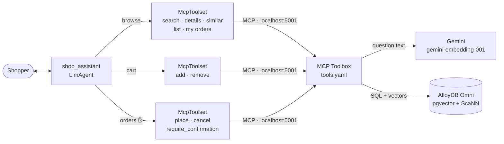

# Shop Assistant (ADK + MCP Toolbox + AlloyDB)

A shopping assistant for **Summit Sports**, a made-up sports store with 42 products. You describe what you need in plain English. It finds gear **by meaning** with vector search in **AlloyDB**, filters by price, size in stock, and category, suggests similar products, keeps a shopping list, and places and cancels orders.

All of its tools come from **[MCP Toolbox for Databases](https://github.com/googleapis/mcp-toolbox)**: 9 SQL tools in [tools.yaml](tools.yaml) plus a Gemini embedding model. The Python code defines no tools.

> `shoes for running in the rain`
> → `#3 Nimbus Athletics StormGuard Runner, $139.99, match 0.93` · `#6 Trailborn Ridge GTX, $149.99, match 0.90`
>
> `waterproof shoes for muddy trails, size 10` → Ridge GTX is **left out**: it matches best, but size 10 is sold out.
>
> `stay visible when jogging at night` → `#12 Tidewater Hi-Vis Running Vest (0.88)`: found by meaning, with almost no words in common.

## How it works



1. **Embeddings.** Each product's `brand + name + category + sport + description` was turned into a 768-number vector **once** by [build_db.py](build_db.py) and saved in [db/03_embeddings.sql](db/03_embeddings.sql), so setting up the store needs no API calls. At search time, the `query` parameter is marked `embeddedBy: gemini-embed`. Toolbox embeds the shopper's words with the same model and passes the vector to SQL. This uses the AI Studio key, so no Vertex AI is needed.
2. **Hybrid search in one query.** `ORDER BY embedding <=> $1::vector` ranks by meaning (cosine distance). The `WHERE` clause applies exact filters: `price <= max_price`, the size in stock, and a category word. A separate vector database can't combine those two in one step.
3. **ScaNN index.** `alloydb_scann` is AlloyDB's approximate nearest-neighbour index (`USING scann (embedding cosine)`). With 42 products a plain scan is just as fast, but the plan shows the index is used once it pays off, and the SQL stays the same at a million rows.

| File | Purpose |
|---|---|
| [agent.py](agent.py) | `root_agent`, the three toolsets, and the `enforce_identity` callback |
| [tools.yaml](tools.yaml) | Toolbox config: AlloyDB source, Gemini embedding model, 9 SQL tools |
| [db/](db/) | Schema, generated catalog (42 products, 150 size/stock rows), and generated embeddings + ScaNN index |
| [build_db.py](build_db.py) | Generates the catalog SQL (free) and the embeddings SQL (one Gemini call) |
| [config.py](config.py) | Model, Toolbox URL, tool groups, weak-match cutoff |
| [docker-compose.yml](docker-compose.yml) | AlloyDB Omni 17.10 on port 5434 |
| [tests/](tests/) | Tool tests over real MCP (orders, stock, identity) |

## What this version adds

The starting point was Google's [sports-agent-adk-mcp-alloydb](https://github.com/mtoscano84/sports-agent-adk-mcp-alloydb) codelab. This version adds:

1. **Hybrid search with a match score.** One query combines meaning, budget, a size that is actually in stock, and category, and every result carries a `match_score`. The agent calls results weak below **0.80**. That cutoff was measured, not guessed: real matches scored 0.88–0.93, but unrelated requests (`chess set`, `laptop charger`) still scored ~0.77, because this model's cosine scores sit in a narrow band.
2. **Safe orders.** `place-order` is **one SQL statement**, so it is all or nothing. It locks the stock rows (`FOR UPDATE`), orders only if every line is in stock, creates the order and its lines at today's prices, lowers the stock, and empties the list. Otherwise it changes nothing and says which item is short. `CHECK (stock >= 0)` is a second safety net. `cancel-order` only works on your own `Placed` orders and returns the stock in the same statement. Placing and cancelling use `require_confirmation=True`, so ADK pauses until the shopper approves the exact call.
3. **Identity from the session, not the model.** A `before_tool_callback` overwrites `user_id` on every list and order tool with the ADK session's user. Asking for another shopper's orders still only returns your own, and the attempt is logged.
4. **"More like this".** `similar-products` compares a product's stored vector with all others: no embedding call, so it's free and instant.

Also changed:

- **AlloyDB Omni instead of a cloud cluster.** It is the same AlloyDB engine (pgvector, ScaNN, AlloyDB AI extensions) as a free container, with no cloud cost. For AlloyDB in Google Cloud, change the source in `tools.yaml` to `type: alloydb-postgres` with the project, region, cluster, and instance. The tools stay the same.
- **Inputs validated by Toolbox before any SQL runs:** quantity 1–5 (`minValue`/`maxValue`). Database constraints reject unknown sizes (foreign key) and bad statuses (`CHECK`).
- **The reference's React front end and Google sign-in were left out.** `adk web` is the UI, as in the other agents.

## Measured

| Check | Result |
|---|---|
| Embedding the catalog (one call, 42 texts) | ~1,300 tokens, about **$0.0002**, done once |
| Fresh setup (`docker compose up` with schema, catalog, embeddings, index) | ~5 s, no API calls |
| Order 2 when 1 is in stock | refused, nothing changed |
| 2-item order with one item sold out | **nothing** ordered, in-stock item untouched, list kept |
| Order → cancel | stock back to the original; a second cancel is refused |
| Cancel another shopper's order / size 15 / quantity 50 | all refused |

## Problems found while building

- **The health check said "ready" too early.** On first start, the Postgres entrypoint runs a temporary socket-only server for the setup scripts. `pg_isready` passed against it, so the next query hit "the database system is shutting down". Checking over TCP (`pg_isready -h 127.0.0.1`) waits for the real server.
- **A test expected stock that wasn't there.** The first order test asked for 2 pairs while only 1 was in stock, and `place-order` correctly refused. The test now reads the stock first.
- **Similarity scores needed calibrating** (see addition 1). A typical 0.6 cutoff would have treated every product as a good match for "chess set".

## Run locally

From the repository root:

```bash
python3.13 -m venv .venv && source .venv/bin/activate
pip install -r requirements.txt
cp shop_agent/.env.example shop_agent/.env      # add your Gemini API key (used for search embeddings)

docker compose -f shop_agent/docker-compose.yml up -d --wait   # AlloyDB Omni, loads everything

# MCP Toolbox v1.17.0 (macOS Apple Silicon; the script also reuses ../bug_assistant_agent/toolbox)
curl -L -o shop_agent/toolbox \
  https://storage.googleapis.com/mcp-toolbox-for-databases/v1.17.0/darwin/arm64/toolbox
chmod +x shop_agent/toolbox
./shop_agent/run_toolbox.sh            # leave running in its own terminal

adk web                                # second terminal
```

Open http://127.0.0.1:8000 and pick **shop_agent**. When an order asks for approval, tick **Confirmed** and **Submit**.

```bash
python -m unittest discover -s shop_agent/tests -t . -v    # tool tests (free; needs the DB and Toolbox)
python shop_agent/build_db.py catalog                      # after editing the products in build_db.py
python shop_agent/build_db.py embeddings                   # re-embed them (one Gemini call)
docker compose -f shop_agent/docker-compose.yml down -v    # reset all data
```

## Credits

Based on Google's [sports-agent-adk-mcp-alloydb](https://github.com/mtoscano84/sports-agent-adk-mcp-alloydb) codelab. Rebuilt on AlloyDB Omni and MCP Toolbox v1, with Toolbox-side Gemini embeddings (no Vertex AI), measured hybrid search, a single-statement all-or-nothing order, approval for orders, session-enforced identity, and "more like this".
